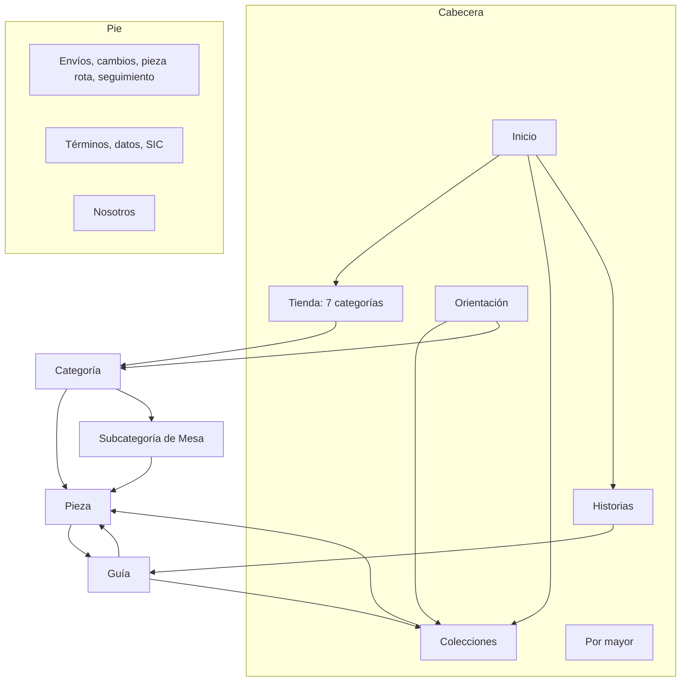

# Arquitectura de información · Historias que Habitan

Versión 2 · 15/11/2026 · Estado: propuesta de diseño, sin validar con usuarios.
Skill que manda en la estructura: `/marketing-skills:site-architecture`. La versión 1 se apoyó en un módulo de auditoría que necesita una página publicada; esta versión la reemplaza.
Lo que depende de evidencia va como [HIPÓTESIS A VALIDAR]; lo que depende de una decisión del negocio, como [POR CONFIRMAR].

## 1. Contexto

- **Tipo de sitio:** tienda en línea nueva, sin URLs anteriores que conservar.
- **Audiencias:** detal (casa, regalo, espacio para lucir) y comercios que compran por mayor.
- **Objetivos del sitio:** vender desde redes y búsqueda, atraer tráfico orgánico con las guías, y recibir cotizaciones por mayor.
- **Las cinco páginas más importantes:** ficha de pieza, categoría, colección, inicio y pago.

## 2. Principio

| Entrada | Responde a | Ejemplo de búsqueda | Ejemplo |
|---|---|---|---|
| **Categoría** | Qué objeto es | «jarrones decorativos» | Jarrones y recipientes |
| **Colección** | Para qué momento o ambiente | «regalo de boda», «decorar primer apartamento» | Primer hogar |

Una pieza vive en **una sola categoría**, que define su URL y su miga de pan, y puede aparecer en **varias colecciones**.

## 3. Jerarquía de páginas

```
Inicio (/)
├── Porcelanas y figuras (/porcelanas)
│   └── Pieza (/porcelanas/{pieza})
├── Jarrones y recipientes (/jarrones)
│   └── Pieza (/jarrones/{pieza})
├── Flores artificiales (/flores-artificiales)
├── Mesa (/mesa)
│   ├── Vajillas (/mesa/vajillas)
│   │   └── Pieza (/mesa/vajillas/{pieza})
│   ├── Cristalería (/mesa/cristaleria)
│   └── Accesorios de mesa (/mesa/accesorios)
├── Centros de mesa (/centros-de-mesa)
├── Esculturas pequeñas (/esculturas)
├── Decoraciones del hogar (/decoracion)            [POR CONFIRMAR: qué incluye]
├── Colecciones (/colecciones)
│   ├── La mesa que recibe (/colecciones/la-mesa-que-recibe)
│   ├── Primer hogar (/colecciones/primer-hogar)
│   └── Regalos que se guardan (/colecciones/regalos-que-se-guardan)
├── Historias (/historias)
│   └── Guía o relato (/historias/{titulo})
├── Orientación (/orientacion)
├── Por mayor (/por-mayor)
├── Nosotros (/nosotros)
├── Ayuda: /envios · /cambios-y-garantia · /pieza-rota · /seguimiento · /preguntas
├── Legal: /terminos · /politica-de-datos
└── Sin indexar: /buscar · /carrito · /pago
```

Profundidad: cualquier pieza queda a tres clics o menos del inicio. La más honda es Inicio → Mesa → Vajillas → pieza.



## 4. Mapa de URLs

| Página | URL | Madre | Dónde se enlaza | Prioridad |
|---|---|---|---|---|
| Inicio | `/` | — | Logo | Alta |
| Categoría | `/jarrones` | Inicio | Cabecera (Tienda), inicio | Alta |
| Subcategoría | `/mesa/vajillas` | Mesa | Página de Mesa, menú | Media |
| Pieza | `/jarrones/jarron-ceramica-blanca-con-asas` | Categoría | Categoría, colecciones, guías, redes | Alta |
| Listado de colecciones | `/colecciones` | Inicio | Cabecera | Media |
| Colección | `/colecciones/primer-hogar` | Colecciones | Cabecera, inicio, quiz, fichas | Alta |
| Listado de guías | `/historias` | Inicio | Cabecera | Media |
| Guía | `/historias/como-poner-la-mesa-para-recibir` | Historias | Inicio, fichas, colecciones | Media |
| Orientación | `/orientacion` | Inicio | Cabecera, inicio, lista sin resultados | Media |
| Por mayor | `/por-mayor` | Inicio | Cabecera, pie | Media |
| Ayuda y legal | `/envios`, `/terminos`… | Inicio | Pie, ficha, pago | Baja |

Reglas: minúsculas, sin tildes ni ñ en la ruta, guiones, sin fechas ni códigos, sin barra final. El nombre de la pieza en la ruta sigue el orden tipo + material + rasgo.

**Cambio frente a la versión 1.** La pieza pasa de `/pieza/{nombre}` a `/{categoria}/{nombre}`, y las colecciones de `/coleccion/…` a `/colecciones/…`, para que la URL y la miga de pan digan lo mismo y cada sección tenga su página madre. Costo: si una pieza cambia de categoría, su URL cambia y necesita una redirección 301. Por eso la categoría de cada pieza se decide con cuidado y no se mueve por temporada; para eso están las colecciones.

## 5. Navegación

**Cabecera (5 enlaces, dentro del límite de 4 a 7):** Tienda · Colecciones · Historias · Orientación · Por mayor. A la derecha, buscar y carrito. El logo lleva al inicio.

**«Tienda»** abre las siete categorías completas y en este orden:

1. Porcelanas y figuras
2. Jarrones y recipientes
3. Flores artificiales
4. Mesa: Vajillas · Cristalería · Accesorios de mesa
5. Centros de mesa
6. Esculturas pequeñas
7. Decoraciones del hogar

**Menú móvil:** buscador arriba, luego Tienda, Colecciones y el resto. Al pie del menú: seguir mi pedido y ayuda por WhatsApp.

**Pie de página, por grupos:**

| Comprar | Ayuda | La marca | Legal |
|---|---|---|---|
| Las 7 categorías, Colecciones | Envíos, Cambios y garantía, Reportar una pieza rota, Seguir mi pedido, Preguntas | Nosotros, Historias, Por mayor | Términos, Tratamiento de datos, SIC, datos del vendedor |

**Migas de pan:** reflejan la URL. `Inicio / Jarrones y recipientes / [pieza]`; `Inicio / Mesa / Vajillas / [pieza]`. Todos los tramos son enlaces menos la página actual. Una pieza abierta desde una colección muestra igual la miga de su categoría.

**Ayuda consistente:** WhatsApp en el mismo lugar en todas las páginas (botón flotante abajo a la derecha, por encima de las barras de compra).

## 6. Enlaces internos

| Desde | Hacia | Cómo |
|---|---|---|
| Inicio | 7 categorías, 3 colecciones, 2 guías, quiz, por mayor | Bloques del inicio |
| Categoría | Sus piezas, subcategorías, categorías vecinas, quiz | Lista, texto de la categoría, estado sin resultados |
| Colección | Sus piezas, la guía que la acompaña | Lista y bloque editorial |
| Pieza | Su categoría, su colección, piezas que combinan, su guía | Miga, enlace a colección, «Piezas que combinan», historia |
| Guía | Colección y piezas que menciona, otras guías del tema | Enlaces en el texto con nombre descriptivo |
| Quiz | Colección o categorías sugeridas | Resultado |

Modelo de núcleo y radios para «Historias»: cada colección tiene una guía principal (por ejemplo, «Cómo poner la mesa para recibir» con «La mesa que recibe»). Las guías menores enlazan a la principal y esta a todas.

Reglas: ninguna página queda sin un enlace entrante; el texto del enlace nombra el destino («Ver la colección Primer hogar», no «ver más»); las guías que recomiendan piezas propias se presentan como contenido de la marca.

## 7. Filtros y orden

Filtros de categoría: **material, color, tamaño, ambiente y precio**. En móvil abren en una hoja inferior con contador («Ver 12 piezas») y «Borrar todo». El precio se filtra con rangos, sin control de arrastre.

| Tipo de URL | Tratamiento |
|---|---|
| Un filtro (`/jarrones?material=ceramica`) | Canonical a la categoría limpia |
| Varios filtros u orden | `noindex` y canonical a la categoría limpia |
| Paginación | Indexable, con canonical propio |

En el lanzamiento ningún filtro genera una página indexable. Las páginas por material, ocasión o ciudad se deciden con `/marketing-skills:programmatic-seo`, no como URLs de filtro.

## 8. Notas para el agente de SEO

1. **Categoría frente a colección:** títulos, H1 y textos no repiten la misma frase entre «Mesa» y «La mesa que recibe».
2. **«Mesa» y «Centros de mesa»** son vecinas: definir qué búsqueda atiende cada una.
3. **«Exclusivo»** nunca va en títulos, metadatos ni schema.
4. **Sin palabras clave todavía:** los nombres de categoría son los del negocio. La investigación va con `/claude-seo:seo-plan` y el card sorting [HIPÓTESIS A VALIDAR].
5. **Datos estructurados:** el diseño ya muestra en pantalla nombre, precio con IVA, disponibilidad, variantes, migas, preguntas, envío y cambios. El marcado se define con `/marketing-skills:schema`. Reseñas, solo cuando sean reales.
6. **Auditorías** (`/claude-seo-ai:audit`, `/claude-seo:seo audit`, `/geo audit`): cuando exista una URL o un build local.

## 9. Qué cambia según la plataforma [POR CONFIRMAR]

| Tema | Shopify | Next.js a medida |
|---|---|---|
| URLs | Prefijos fijos: `/collections/jarrones`, `/products/…`. La pieza no puede colgar de su categoría; la miga se arma a mano. | Rutas exactas de este documento |
| Categorías y colecciones | Ambas son «collections»; se distinguen con un metacampo y plantillas distintas | Dos tipos de contenido |
| Subcategorías | Sin anidación real: `/collections/mesa-vajillas` | Anidación real |
| Filtros | Los controla la plataforma (`?filter.…`); canonical y `noindex` se ajustan en el tema | Control total |
| Pago | Propio de Shopify, poco personalizable y ya probado en navegadores internos | Lo construye el equipo con la pasarela |
| Quiz, cotización, carrito en hoja | App o sección a medida | Componentes propios |

## 10. Validación propuesta

| Qué | Cómo | Con quién | Se observa |
|---|---|---|---|
| Nombres y agrupación de categorías | Card sorting abierto con 30 piezas reales | 8 a 10 personas del perfil detal [POR CONFIRMAR: reclutamiento] | Acuerdo en los grupos y palabras que usan |
| Encontrar una pieza | Prueba de árbol con 5 tareas («busque un regalo de boda») | 5 personas, en celular | Éxito y ruta directa |
| Categoría frente a colección | Preguntar dónde buscarían «algo para recibir invitados» | Las mismas 5 | Si usan colección, categoría o buscador |
| Entrada mayorista | Prueba aparte con 3 comercios | Dueños o compradores | Si encuentran «Por mayor» sin ayuda |
